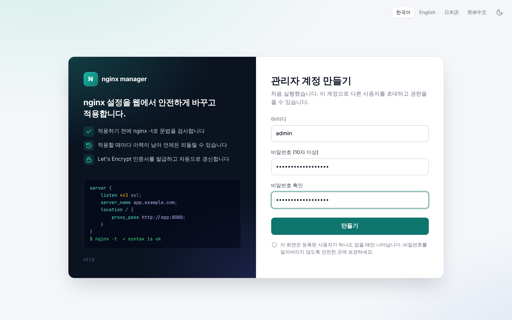
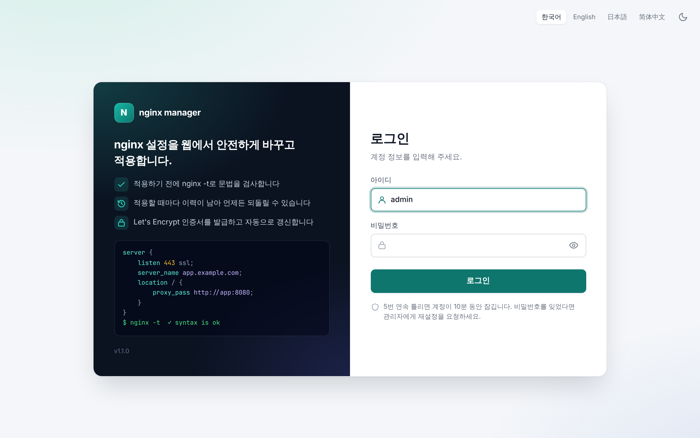
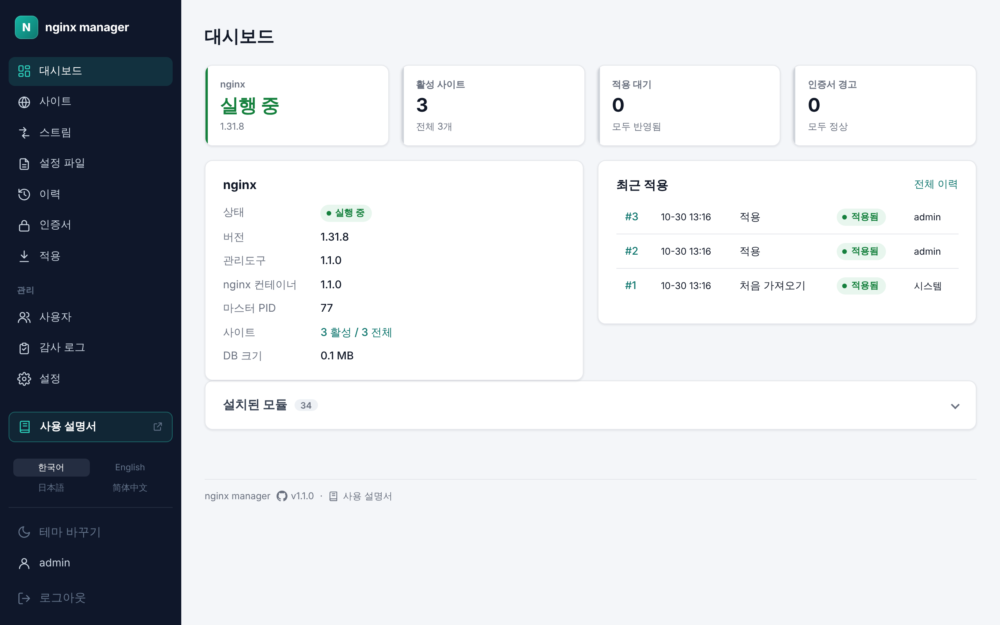
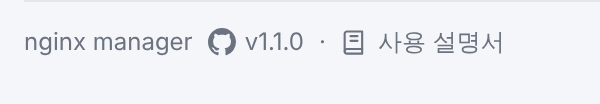
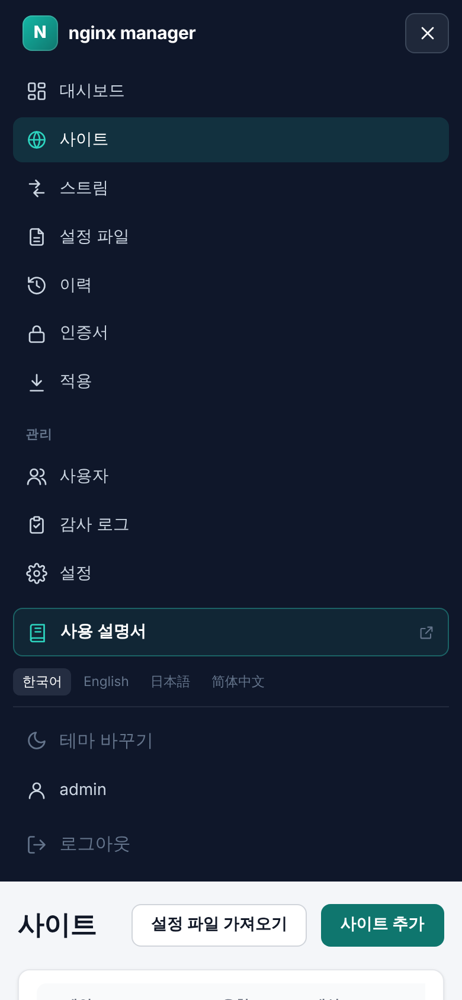
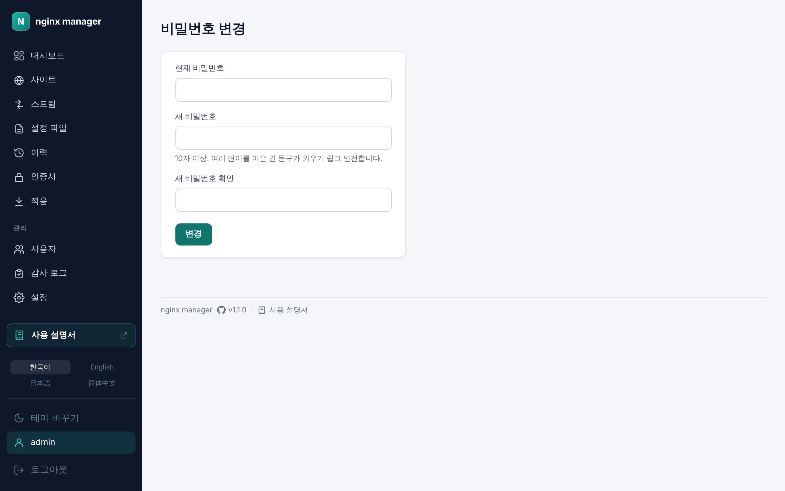

# 2. 처음 시작하기

[← 설치와 실행](01-install.md) · [차례](README.md) · [다음: 대시보드 →](03-dashboard.md)

## 최초 관리자 계정 만들기

설치한 뒤 `http://<서버 주소>:9000`에 처음 접속하면 **관리자 계정 만들기** 화면이 나옵니다. 이 화면은 등록된 사용자가 하나도 없을 때만 나타납니다.

1. 아이디를 적습니다. 영문, 숫자, `.` `_` `-`만 쓸 수 있습니다.
2. 비밀번호를 10자 이상으로 두 번 적습니다.
3. **만들기**를 누르면 로그인 화면으로 넘어갑니다.

이 계정은 관리자 역할을 가지며, 다른 사용자를 추가하고 권한을 줄 수 있습니다([12장](12-admin.md#사용자)). 비밀번호를 잃어버리면 되찾을 방법이 없으니 안전한 곳에 보관하세요.

## 로그인

아이디와 비밀번호로 로그인합니다.

- 5번 연속 틀리면 계정이 10분 동안 잠깁니다. 시간이 지나면 저절로 풀립니다.
- 비밀번호를 잊었다면 관리자에게 재설정을 요청합니다.
- 관리자가 내 역할을 바꾸거나 비밀번호를 재설정하면 바로 로그아웃되고, "계정 정보가 바뀌어 로그아웃됐습니다"라는 안내가 나옵니다.

## 화면 구성

- **왼쪽 메뉴**: 대시보드, 사이트, 스트림, 설정 파일, 이력, 인증서, 적용이 있습니다. 관리자에게는 **관리** 아래에 사용자, 감사 로그, 설정이 더 보입니다. 메뉴 아래 테두리가 있는 **사용 설명서** 단추는 이 문서를 새 탭으로 엽니다. 적용 메뉴 옆의 숫자는 아직 적용하지 않은 초안 수입니다. 보기 전용 사용자에게는 적용 메뉴가 보이지 않습니다.
- **언어**: 메뉴 아래에서 한국어, English, 日本語, 简体中文 중에 고릅니다. 고른 언어는 브라우저에 기억됩니다.
- **테마 바꾸기**: 밝은 화면과 어두운 화면(다크 모드)을 바꿉니다. 처음에는 운영체제 설정을 따릅니다.
- **내 계정과 로그아웃**: 메뉴 맨 아래의 아이디를 누르면 [내 계정](#내-계정)으로 갑니다. 그 아래 **로그아웃**이 있습니다.
- **경고 띠**: nginx 컨테이너에 연결할 수 없거나 두 컨테이너의 버전이 다르면, 또는 서버에서 설정 파일이 직접 바뀌었으면 화면 위에 띠가 나타납니다([13장](13-troubleshooting.md)).
- **footer**: 화면 맨 아래에 GitHub 아이콘과 관리도구 버전, **사용 설명서** 링크가 있습니다. 버전을 누르면 GitHub에서 그 버전의 릴리스 노트가, 사용 설명서를 누르면 이 문서가 열립니다.

### 휴대폰에서

화면 폭이 좁으면 왼쪽 메뉴가 오른쪽 위의 메뉴 단추(≡) 안으로 들어갑니다. 단추를 눌러 메뉴를 엽니다. 적용 대기 수는 단추에도 보입니다. 표와 설정 원문은 상자 안에서만 가로로 밀어 봅니다.

## 내 계정

메뉴 맨 아래의 내 아이디를 누르면 비밀번호를 바꾸는 화면이 나옵니다.

1. 현재 비밀번호를 적습니다.
2. 새 비밀번호를 10자 이상으로 두 번 적습니다. 여러 단어를 이은 긴 문구가 외우기 쉽고 안전합니다.
3. **변경**을 누릅니다.

관리자가 처음 정해 준 비밀번호로 로그인했다면 여기서 바로 바꾸세요.

