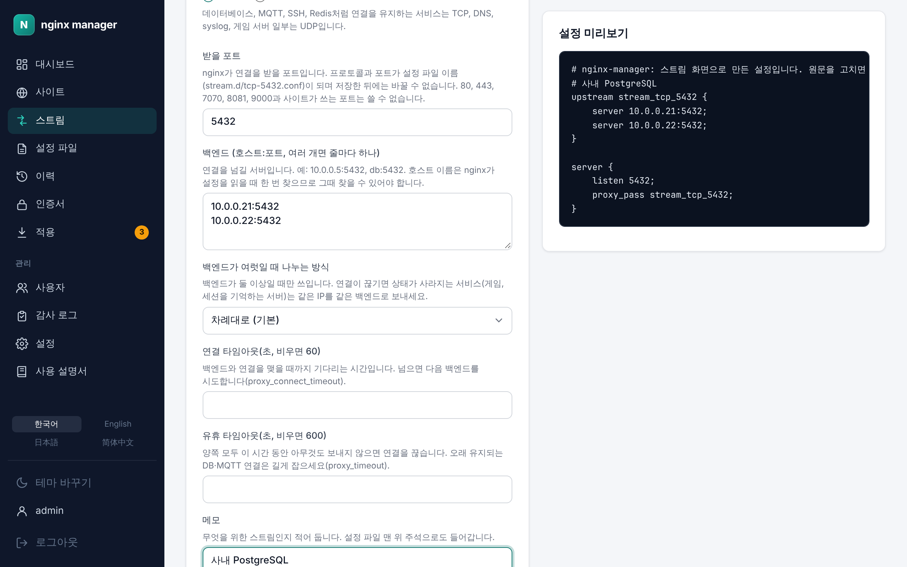

# 6. 스트림 (TCP/UDP)

[← 설정 파일 가져오기](05-import.md) · [차례](README.md) · [다음: 적용 →](07-apply.md)

데이터베이스, MQTT, SSH, DNS, 게임 서버처럼 HTTP가 아닌 서비스를 nginx 뒤에 둡니다. 받은 TCP/UDP 연결을 내용을 보지 않고 그대로 백엔드로 넘깁니다(nginx stream 모듈).

## 스트림 만들기

**스트림** 메뉴에서 **스트림 추가**를 누릅니다.

<p align="center"></p>

| 항목 | 설명 |
| --- | --- |
| 프로토콜 | 연결을 유지하는 서비스(DB, MQTT, SSH, Redis)는 TCP, DNS·syslog·일부 게임 서버는 UDP |
| 받을 포트 | nginx가 연결을 받을 포트. 프로토콜과 포트가 설정 파일 이름(`stream.d/tcp-5432.conf`)이 되며 저장한 뒤에는 바꿀 수 없습니다. 80, 443, 7070, 8081, 9000과 사이트가 쓰는 포트는 쓸 수 없습니다. |
| 백엔드 | `호스트:포트`를 줄마다 하나씩(예: `10.0.0.5:5432`, 최대 32개). 호스트 이름은 nginx가 설정을 읽을 때 찾을 수 있어야 합니다. |
| 나누는 방식 | 백엔드가 여럿일 때. 차례대로(기본), 연결이 가장 적은 백엔드로, 같은 클라이언트 IP는 같은 백엔드로 |
| 연결 타임아웃 | 백엔드와 연결을 맺을 때까지 기다리는 시간(초, 비우면 60). 넘으면 다음 백엔드를 시도합니다. |
| 유휴 타임아웃 | 양쪽 모두 이 시간 동안 아무것도 보내지 않으면 연결을 끊습니다(초, 비우면 600). 오래 유지되는 DB·MQTT 연결은 길게 잡습니다. |
| 메모 | 무엇을 위한 스트림인지 적어 둡니다. 설정 파일 맨 위 주석으로도 들어갑니다. |

사이트와 같이 저장하면 초안이 되고, [적용](07-apply.md) 화면에서 반영합니다.

## 포트 열기

nginx 컨테이너는 compose 파일에 적은 포트만 밖으로 엽니다. 스트림을 만든 뒤 compose 파일의 `nginx` 서비스 `ports`에 그 포트를 더하고 nginx를 다시 띄웁니다. 스트림 화면에도 더할 줄이 안내됩니다.

```yaml
  nginx:
    ports:
      - "80:80"
      - "443:443"
      - "443:443/udp"
      - "5432:5432"      # TCP 스트림
      - "53:53/udp"      # UDP 스트림
```

```bash
docker compose up -d nginx
```

## 고치기와 지우기

스트림 목록에서 포트를 눌러 스트림 화면을 엽니다. 백엔드, 나누는 방식, 타임아웃, 메모를 고칠 수 있습니다. 프로토콜과 포트는 바꿀 수 없으니, 바꾸려면 **스트림 지우기 (초안)**로 지우고 새로 만듭니다.

SNI로 연결을 나누는 것처럼 폼에 없는 설정은 [설정 파일](10-files.md)에서 `stream.d/` 아래 파일을 원문으로 고치거나 새로 만듭니다. 원문으로 고친 스트림은 **원문 편집** 표시가 붙고 폼이 다시 덮어쓰지 않습니다.
