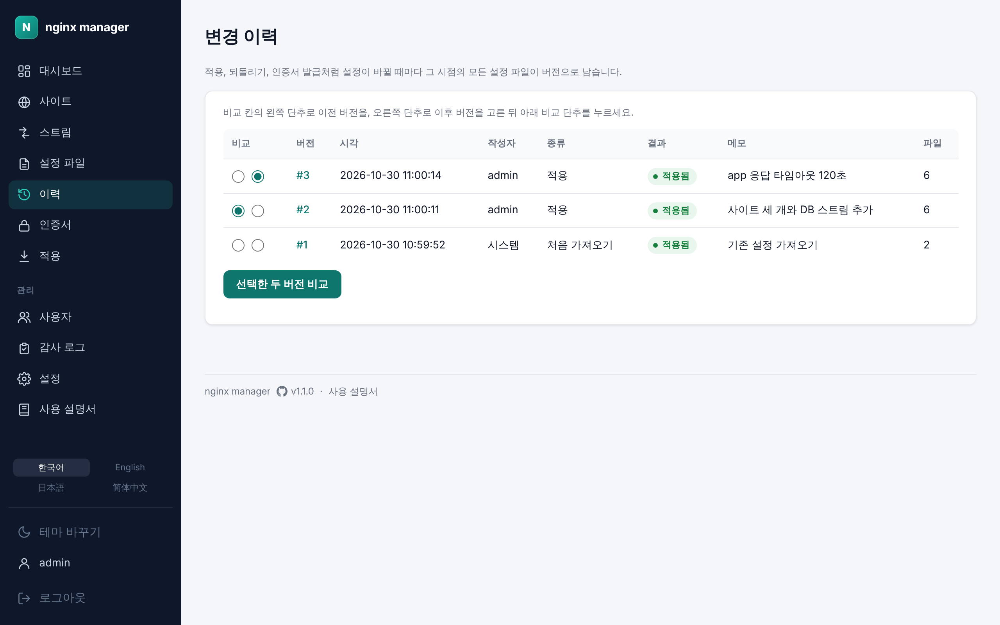
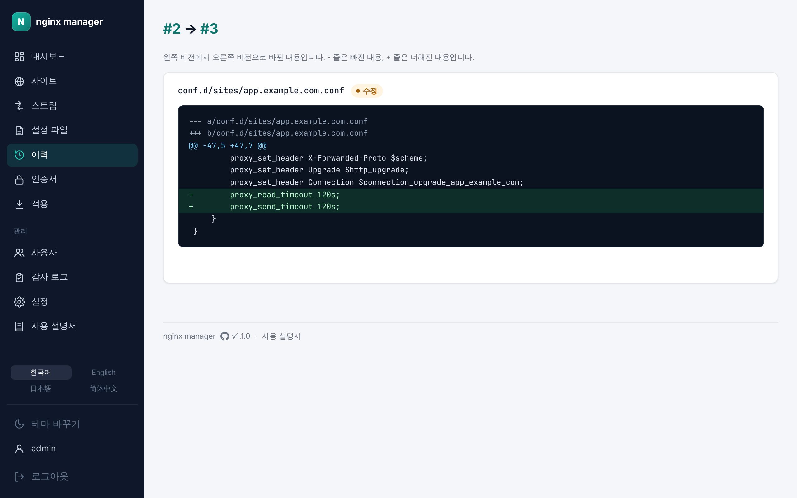
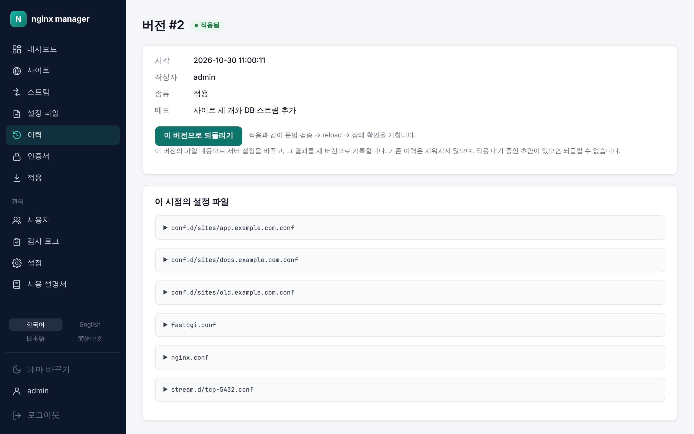

# 8. 이력과 되돌리기

[← 적용](07-apply.md) · [차례](README.md) · [다음: 인증서 →](09-certs.md)

적용, 되돌리기, 인증서 발급·갱신처럼 설정이 바뀔 때마다 그 시점의 모든 설정 파일이 **버전**으로 남습니다. **이력** 메뉴에서 봅니다.

## 버전 목록

| 칸 | 내용 |
| --- | --- |
| 버전 | 버전 번호. 누르면 그 버전의 화면이 열립니다. |
| 시각, 작성자 | 언제 누가 바꿨는지. 인증서 자동 갱신처럼 사람이 하지 않은 변경은 **시스템**입니다. |
| 종류 | 처음 가져오기, 적용, 되돌리기, 외부 변경 가져오기, 인증서 발급, 인증서 갱신 |
| 결과 | 적용됨, 검증 실패, 자동 복구 |
| 메모 | 적용할 때 적은 변경 메모 |
| 파일 | 바뀐 파일 수 |

## 두 버전 비교

1. **비교** 칸의 왼쪽 단추로 이전 버전을, 오른쪽 단추로 이후 버전을 고릅니다. 처음에는 최근 두 버전이 골라져 있습니다.
2. **선택한 두 버전 비교**를 누릅니다.

파일마다 추가·삭제·수정이 표시되고, 왼쪽 버전에서 오른쪽 버전으로 바뀐 내용이 diff로 보입니다. 실패한 버전은 적용하려던 파일만 담고 있어 그 파일들만 비교합니다.

## 이전 버전으로 되돌리기

1. 이력에서 돌아갈 버전을 눌러 버전 화면을 엽니다. 그 시점의 설정 파일이 모두 보입니다.
2. **이 버전으로 되돌리기**를 누릅니다(편집자부터).

되돌리기도 적용과 같이 문법 검증 → reload → 상태 확인을 거치고, 그 결과를 **새 버전**으로 기록합니다. 기존 이력은 지워지지 않으므로 되돌리기를 다시 되돌릴 수도 있습니다.

되돌릴 수 없는 경우:

- 적용 대기 중인 초안이 있으면 되돌리지 않습니다. 적용 화면에서 먼저 적용하거나 버립니다.
- 검증 실패·자동 복구로 끝난 버전은 전체 설정을 담고 있지 않아 되돌릴 수 없습니다.
- 서버의 설정이 이미 그 버전과 같으면 바꿀 것이 없다고 알려 줍니다.

## 서버에서 직접 바뀐 설정

누군가 서버에서 설정 파일을 직접 고치면, 관리도구가 마지막으로 적용한 내용과 디스크의 파일이 달라집니다. 이를 감지하면 모든 화면 위에 "서버에서 직접 바뀐 설정 파일이 N개 있습니다" 띠가 나타나고, 이력 화면 위에 바뀐 파일(바뀜, 새 파일, 사라짐)이 보입니다.

두 가지 중 하나를 고릅니다.

- **바뀐 내용을 받아들이기**: **지금 상태를 새 버전으로 가져오기**를 누릅니다. 디스크의 파일은 그대로 두고 지금 내용을 새 버전(**외부 변경 가져오기**)으로 기록해, 이후 이력과 되돌리기의 기준으로 삼습니다.
- **바뀐 내용을 버리기**: 가져오지 말고, 원하는 이전 버전으로 되돌립니다.
