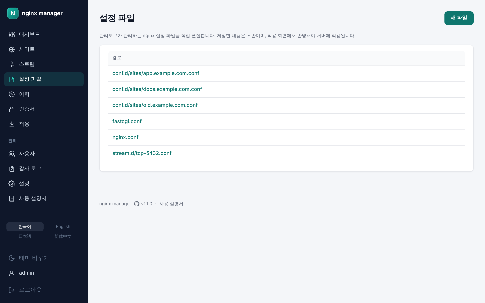
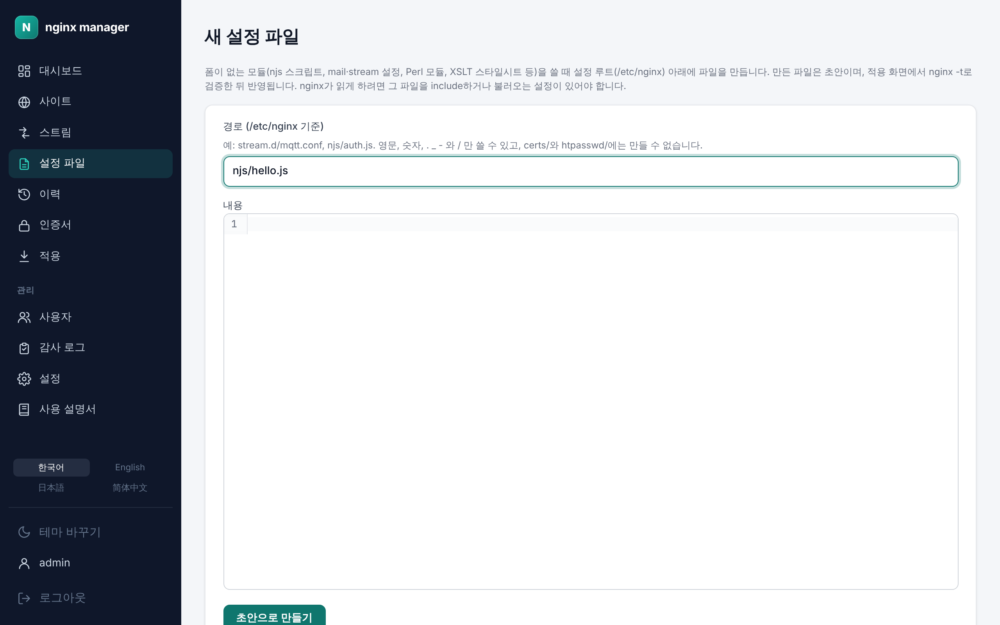

# 10. 설정 파일

[← 인증서](09-certs.md) · [차례](README.md) · [다음: 로그 →](11-logs.md)

폼으로 다룰 수 없는 설정은 **설정 파일** 메뉴에서 원문으로 고칩니다. 관리도구가 관리하는 `/etc/nginx` 아래 모든 설정 파일이 보입니다.

## 파일 고치기

1. 목록에서 경로를 눌러 편집기를 엽니다. nginx 문법 강조가 있습니다.
2. 고친 뒤 **초안 저장**을 누릅니다. 서버의 파일은 그대로이고, 목록에 **적용 대기**가 붙습니다.
3. [적용](07-apply.md) 화면에서 검증 후 적용합니다. 적용하기 전이면 초안을 버릴 수 있습니다.

폼으로 만든 사이트의 파일을 여기서 저장하면, 그 사이트는 원문 편집 전용으로 바뀌어 폼으로 다시 고칠 수 없습니다. 편집기 위에 이 사실이 안내됩니다.

## 새 파일 만들기

njs 스크립트, mail·stream 설정, Perl 모듈, XSLT 스타일시트처럼 폼이 없는 모듈을 쓸 때 **새 파일**로 파일을 만듭니다.

1. **경로**를 `/etc/nginx` 기준으로 적습니다(예: `stream.d/mqtt.conf`, `njs/auth.js`). 영문, 숫자, `.` `_` `-`와 `/`만 쓸 수 있고, `certs/`와 `htpasswd/` 아래에는 만들 수 없습니다.
2. **내용**을 적고 **초안으로 만들기**를 누릅니다.
3. 적용 화면에서 `nginx -t`로 검증한 뒤 반영합니다.

nginx가 새 파일을 읽으려면 그 파일을 include하거나 불러오는 설정이 있어야 합니다. 화면이 경로에 따라 안내합니다.

| 위치 | nginx가 읽는 방법 |
| --- | --- |
| `stream.d/` | `nginx.conf`의 stream 블록이 읽습니다. 스트림 화면으로 만들 수 없는 설정(SNI로 나누기 등)을 둡니다. |
| `conf.d/sites/` | http 블록이 읽습니다. 적용하면 원문 편집 사이트로 사이트 목록에 나타납니다. |
| `njs/` | `nginx.conf`나 사이트 설정에서 `js_import njs/파일.js;`로 불러옵니다. |
| 그 밖 | mail 블록 같은 최상위 설정은 `nginx.conf`에 include 줄을 더해 불러옵니다. |

## 파일 지우기

편집기의 **이 파일 지우기 (초안)**를 누르면 지우는 초안이 만들어지고 목록에 **삭제 대기**가 붙습니다. 적용해야 서버에서 지워지고, 그 전에는 적용 화면에서 초안을 버려 되살릴 수 있습니다. `nginx.conf`와 `mime.types`는 지울 수 없고, 사이트 파일은 사이트 화면의 [비활성화](04-sites.md#활성화와-비활성화)로 다룹니다.
