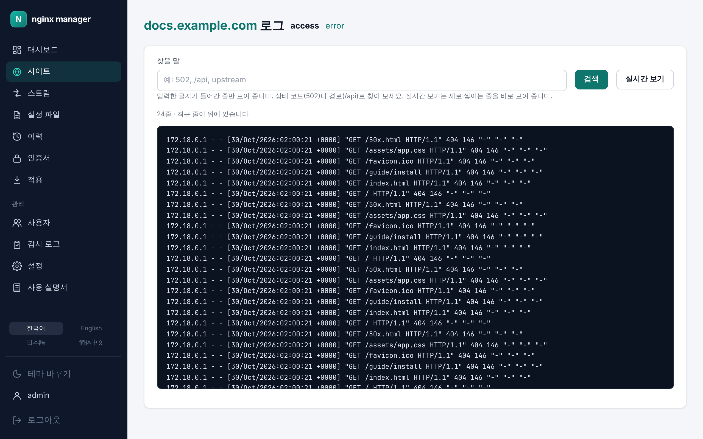

# 11. 로그

[← 설정 파일](10-files.md) · [차례](README.md) · [다음: 관리 →](12-admin.md)

사이트마다 접근 로그(access)와 오류 로그(error)가 따로 남습니다(`/var/log/nginx/sites/`). 사이트 화면의 **로그 보기**로 엽니다.

- 제목 옆의 **access**와 **error**로 로그 종류를 바꿉니다.
- **찾을 말**에 글자를 적고 **검색**을 누르면 그 글자가 들어간 줄만 보여 줍니다. 상태 코드(`502`)나 경로(`/api`), `upstream`처럼 찾아 봅니다. 최근 줄이 위에 있고, 아주 큰 파일은 끝부분에서만 찾습니다.
- **실시간 보기**를 누르면 새로 쌓이는 줄을 바로 아래 **실시간** 칸에 보여 줍니다. 연결이 끊기면 저절로 다시 연결합니다. **실시간 멈추기**로 멈춥니다.
- 사이트로 요청이 한 번도 들어오지 않았으면 로그 파일이 아직 없다고 나옵니다.

로그 파일은 100MB를 넘으면 `.1`, `.2` …로 밀려나고 5개까지 남습니다.
