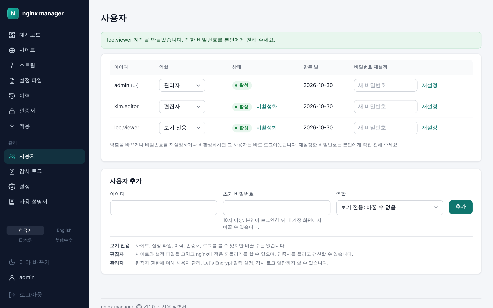
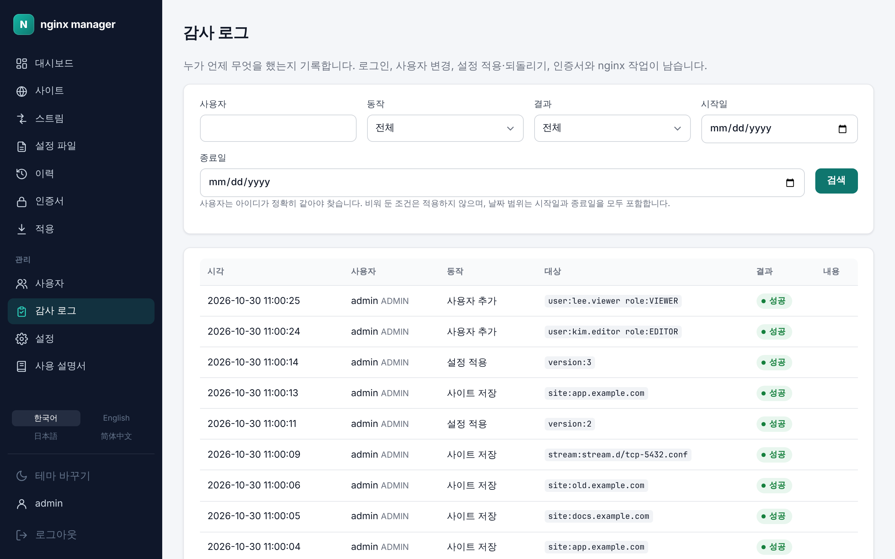
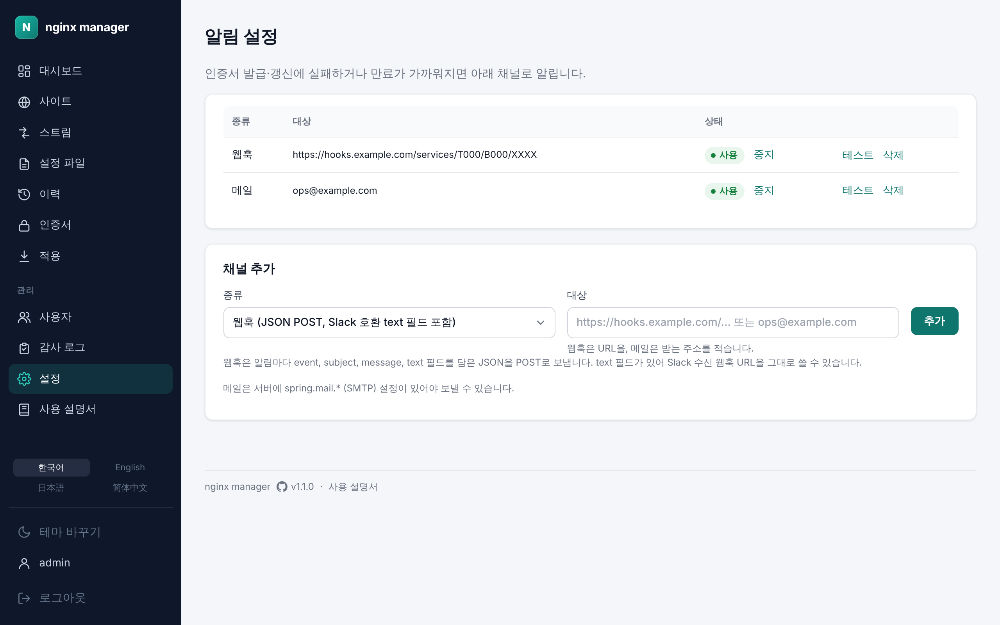

# 12. 관리

[← 로그](11-logs.md) · [차례](README.md) · [다음: 문제 해결 →](13-troubleshooting.md)

관리자에게만 보이는 메뉴입니다. 왼쪽 메뉴의 **관리** 아래에 있습니다.

## 사용자

### 사용자 추가

1. 아래 **사용자 추가**에서 아이디(영문, 숫자, `.` `_` `-`)와 초기 비밀번호(10자 이상)를 적습니다.
2. 역할을 고릅니다: **보기 전용**, **편집자**, **관리자**([역할 표](README.md#역할)).
3. **추가**를 누르고, 정한 비밀번호를 본인에게 직접 전합니다. 본인은 로그인한 뒤 [내 계정](02-getting-started.md#내-계정)에서 비밀번호를 바꿉니다.

### 역할 바꾸기, 비밀번호 재설정, 비활성화

- **역할**: 목록의 역할 칸에서 바로 고릅니다.
- **비밀번호 재설정**: 새 비밀번호(10자 이상)를 적고 **재설정**을 누릅니다. 본인에게 직접 전합니다.
- **비활성화/활성화**: 비활성화한 사용자는 로그인할 수 없습니다. 기록은 남습니다.

역할을 바꾸거나, 비밀번호를 재설정하거나, 비활성화하면 그 사용자는 바로 로그아웃됩니다. 활성 관리자는 최소 한 명 있어야 하므로 마지막 관리자는 바꾸거나 끌 수 없고, 자기 자신은 비활성화할 수 없습니다.

로그인에 5번 연속 실패한 계정은 **잠김**으로 표시되고 10분 뒤 저절로 풀립니다.

## 감사 로그

누가 언제 무엇을 했는지 기록합니다. 로그인, 계정 잠김, 사용자 추가·변경, 사이트 저장, 설정 파일 가져오기, 설정 적용·되돌리기, 직접 변경 가져오기, 인증서 발급·갱신·업로드, nginx 시작·다시 시작·업그레이드가 남습니다. 비밀번호와 키는 남기지 않습니다.

위의 조건으로 좁혀 찾습니다.

- **사용자**: 아이디가 정확히 같아야 찾습니다.
- **동작**, **결과**(성공, 실패)
- **시작일**, **종료일**: 두 날짜를 모두 포함합니다.

비워 둔 조건은 적용하지 않습니다. 인증서 자동 갱신처럼 사람이 하지 않은 동작은 사용자가 **시스템**으로 보입니다. 목록 아래 **← 최근**, **이전 →**으로 넘깁니다.

## 알림 설정

인증서 발급·갱신에 실패하거나 만료가 가까워지면 등록한 채널로 알립니다. **설정** 메뉴(또는 인증서 화면 위의 **알림 설정**)에서 정합니다.

### 채널 추가

1. **종류**를 고릅니다.
   - **웹훅**: 알림마다 `event`, `subject`, `message`, `text` 필드를 담은 JSON을 POST로 보냅니다. `text` 필드가 있어 Slack 수신 웹훅 URL을 그대로 쓸 수 있습니다.
   - **메일**: 서버에 SMTP 설정(`SPRING_MAIL_*` 환경 변수, [1장](01-install.md#환경-변수))이 있어야 보낼 수 있습니다.
2. **대상**에 웹훅 URL 또는 받는 메일 주소를 적고 **추가**를 누릅니다.

### 채널 관리

- **테스트**: 그 채널로 시험 알림을 한 번 보냅니다. 설정이 맞는지 먼저 확인하세요.
- **사용/중지**: 채널을 지우지 않고 잠시 멈춥니다.
- **삭제**: 채널을 지웁니다.

웹훅은 서버가 관리자가 정한 URL로 요청을 보내는 기능이므로, 관리자 역할은 믿을 수 있는 사람에게만 줍니다.
