# v1.0.0 — 첫 정식 릴리스: 사이트·스트림 관리, 안전한 적용, 이력과 되돌리기, HTTPS 자동화

- 날짜: 출시 예정
- 이미지: `ghcr.io/nginx-manager/app:1.0.0`, `ghcr.io/nginx-manager/nginx:1.0.0-nginx1.31.6`
- nginx: 1.31.6 (오픈소스, 전체 모듈 빌드)

> 출시 전 초안입니다. 1.0.0까지 남은 개선을 더하면서 이 노트를 함께 고치고, 출시할 때 날짜를 적고 화면을 다시 찍습니다.

브라우저에서 nginx를 관리하는 첫 정식 버전입니다. nginx와 관리 화면이 컨테이너 두 개로 돌고, `docker compose`로 띄운 뒤 `http://<호스트>:9000`에서 최초 관리자 계정을 만들면 바로 씁니다.

## 사이트를 폼으로 만들기

리버스 프록시와 정적 파일 사이트를 폼으로 만듭니다. 입력하는 동안 만들어질 nginx 설정이 옆에 바로 보입니다.

- 프록시는 백엔드 여러 개(부하 분산 방식 선택), 웹소켓, 연결·읽기 타임아웃까지 폼에서 정합니다.
- 리디렉션 유형, HTTP/3 같은 모듈 옵션도 폼에서 켭니다.
- 폼으로 표현하지 않는 설정은 원문 편집기(nginx 문법 강조)로 고치고, 새 설정 파일을 만들거나 지울 수 있습니다.
- 저장한 내용은 바로 반영되지 않고 초안으로 남습니다.

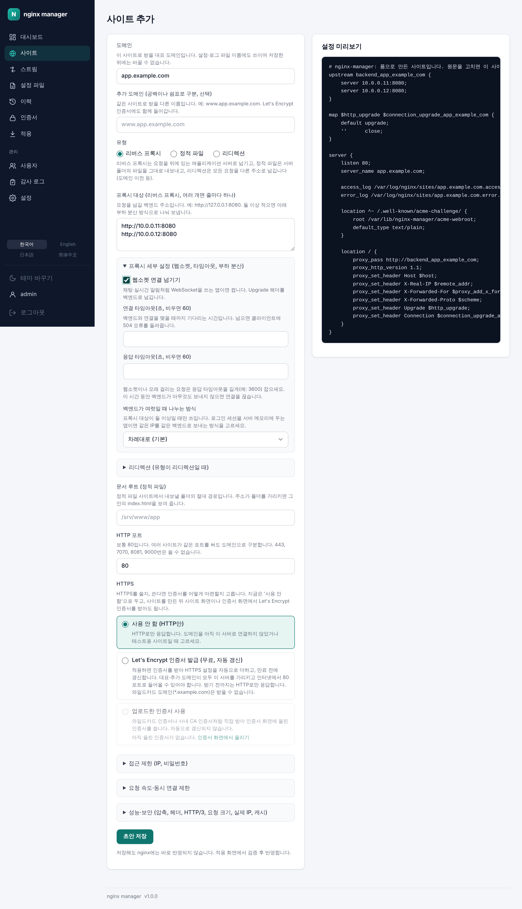

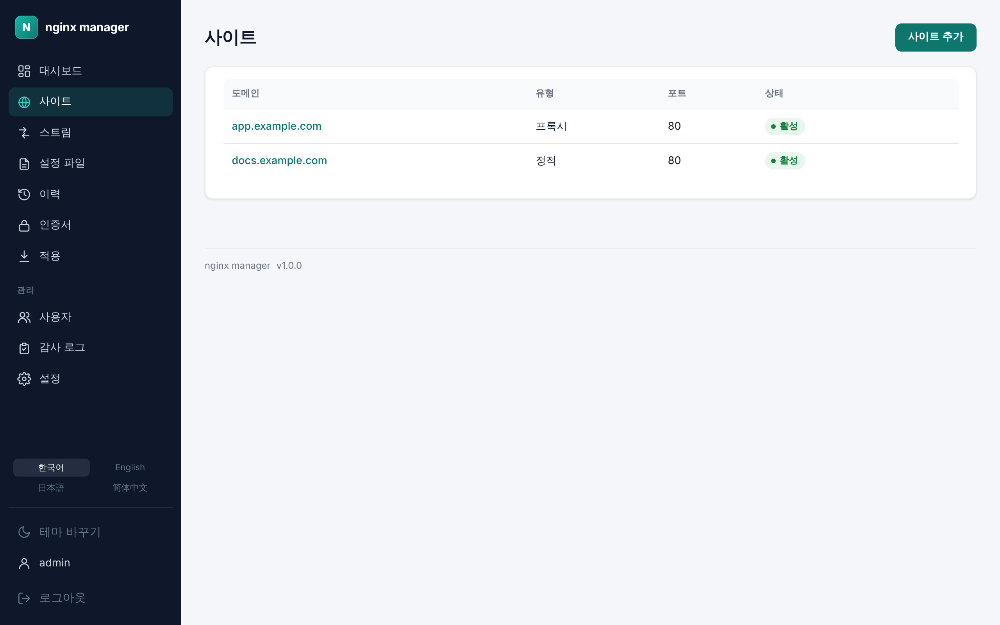

## TCP/UDP 스트림 프록시

데이터베이스, MQTT처럼 HTTP가 아닌 서비스도 포트 단위로 넘깁니다. 백엔드 여러 개와 부하 분산, 연결·유휴 타임아웃을 폼에서 정합니다.

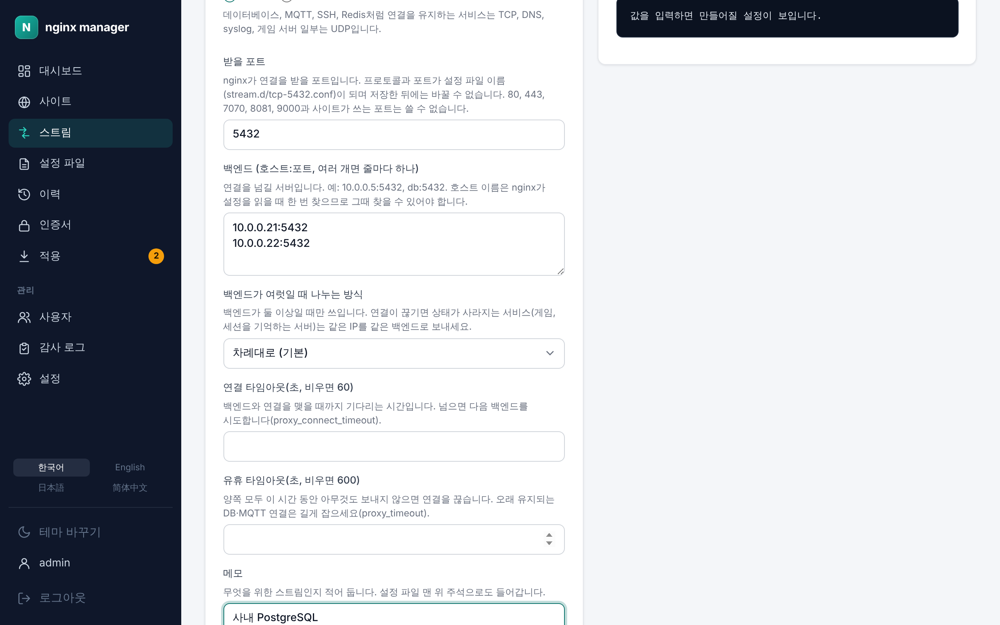

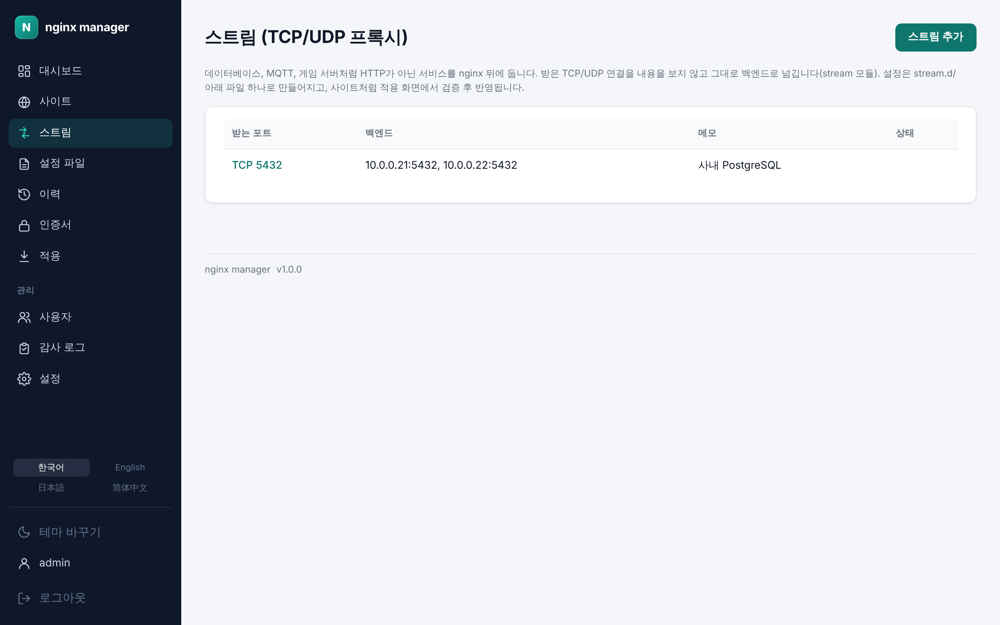

## 확인하고 적용하기, 실패하면 자동으로 되돌리기

초안은 적용 화면에서 파일별 diff로 확인한 뒤 반영합니다. 반영은 `nginx -t` 검증 → reload → 상태 확인 순서로 하고, 어느 단계든 실패하면 직전 설정으로 돌아갑니다. 포트 충돌처럼 `nginx -t`가 못 잡고 reload에서야 드러나는 문제도 실패로 보고 되돌립니다.

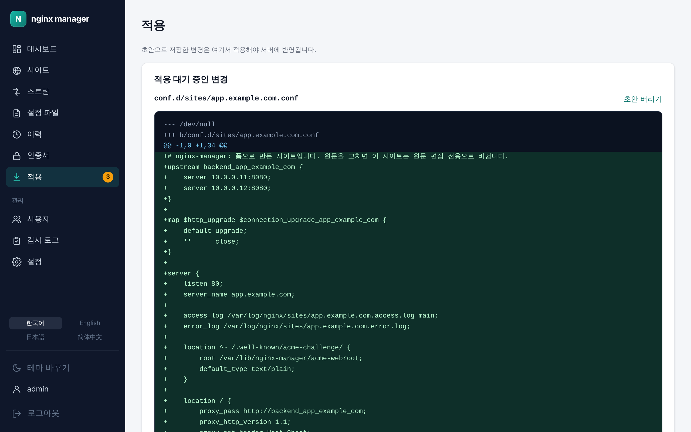

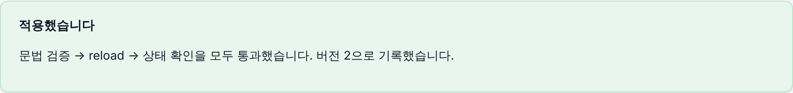

## 이력, 비교, 되돌리기

적용할 때마다 버전이 남습니다. 두 버전을 비교하거나 이전 버전으로 되돌립니다(되돌리기도 같은 검증을 거칩니다). 서버에서 누군가 파일을 직접 고치면 감지해 알려 주고, 그 내용을 새 버전으로 가져올 수 있습니다.

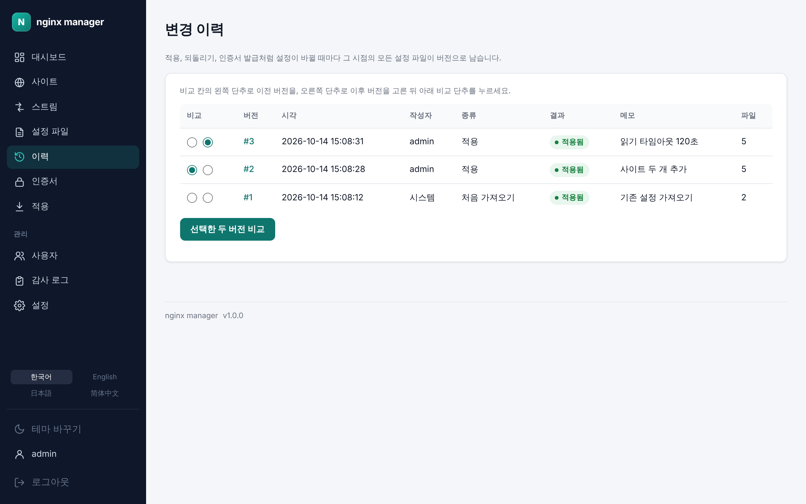

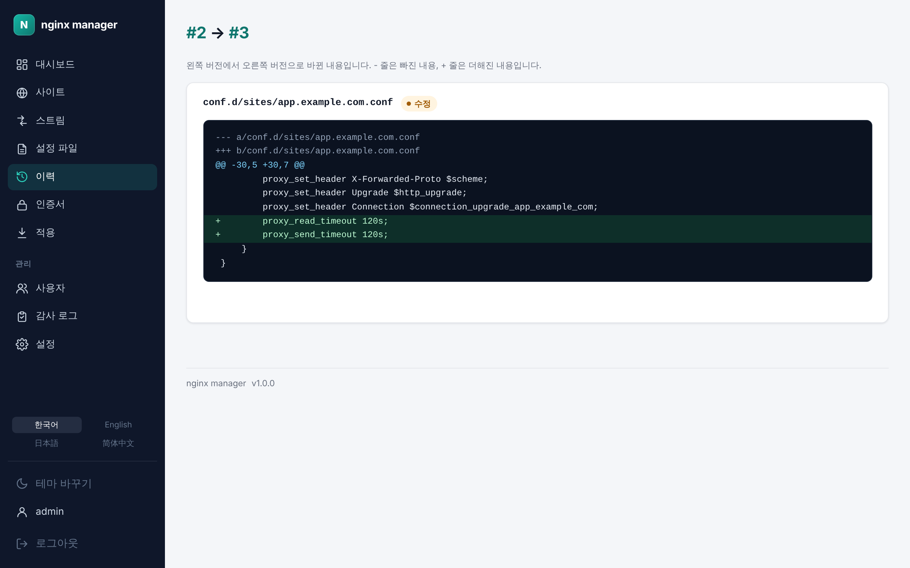

## HTTPS 인증서 자동 발급과 갱신

사이트에서 HTTPS를 고르면 Let's Encrypt 인증서를 받아 설정까지 자동으로 적용하고, 만료 전에 갱신합니다. 이미 만든 사이트에도 나중에 인증서를 받을 수 있습니다. 갱신에 실패하면 지금 인증서로 계속 서비스하면서 메일·웹훅으로 알립니다. 와일드카드·사내 인증서는 업로드합니다.

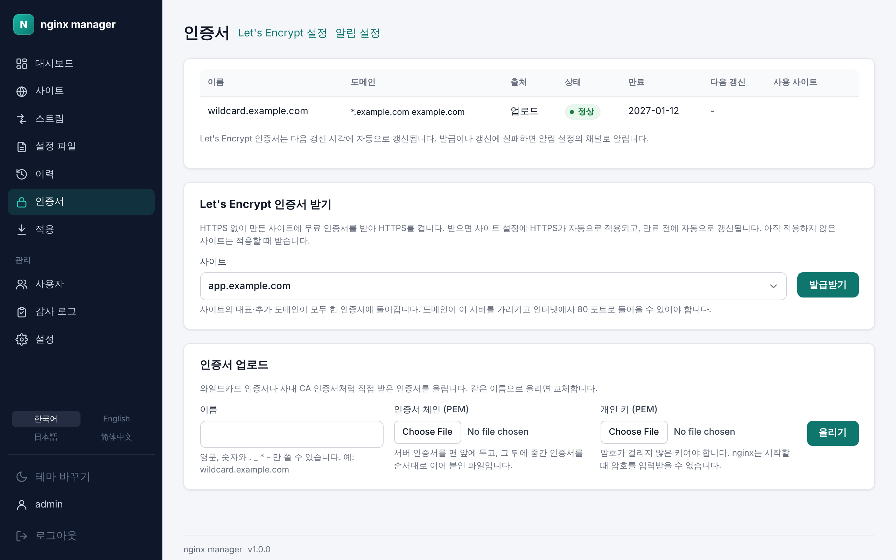

## 대시보드와 로그

대시보드에서 nginx 상태·버전, 설치된 모듈과 각 모듈이 하는 일, 최근 적용, 인증서 경고를 한눈에 봅니다. 사이트별 access/error 로그는 검색하거나 실시간으로 봅니다.

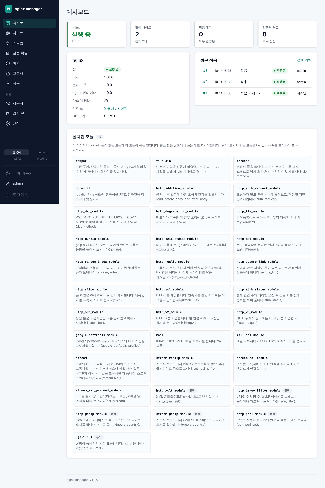

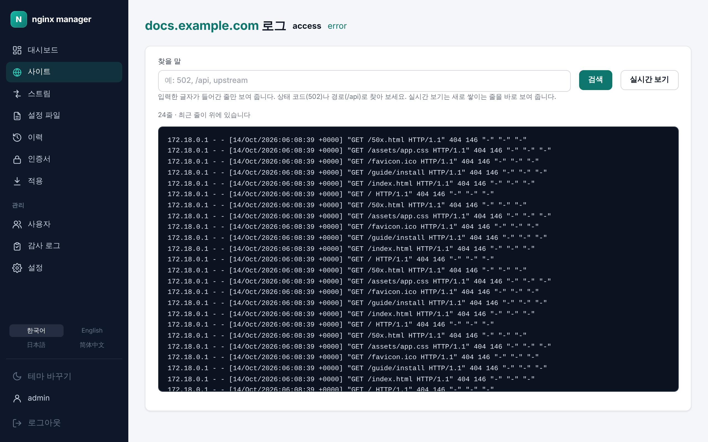

## 4개 언어와 다크 모드

화면을 한국어·영어·일본어·중국어(간체)로 볼 수 있고, 어두운 테마로 바꿀 수 있습니다.

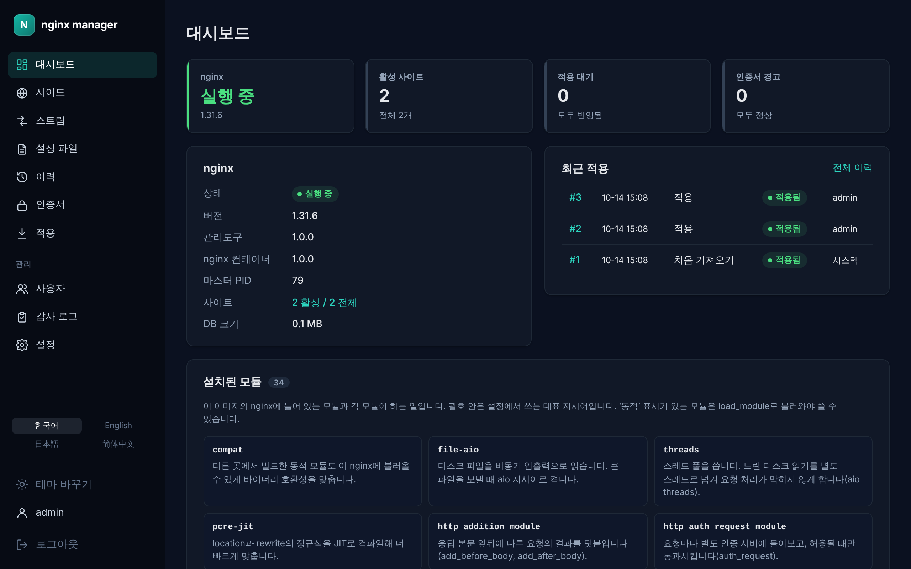

## 사용자와 감사 로그

관리자·편집자·조회자 역할을 나눠 계정을 만들고, 모든 변경은 누가 언제 무엇을 했는지 감사 로그에 남습니다.

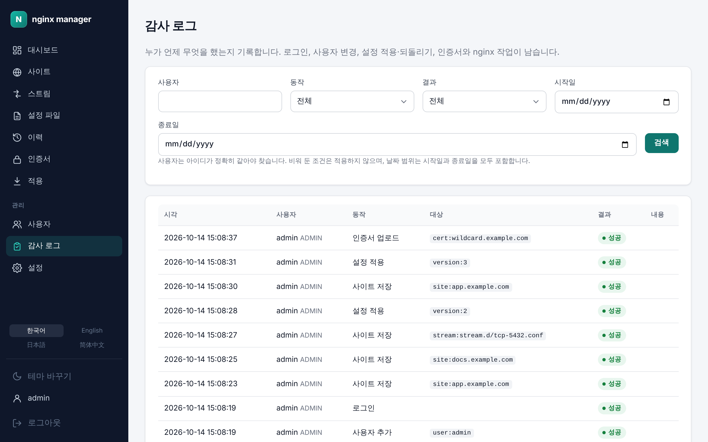

## 컨테이너 두 개와 업그레이드 안전장치

nginx와 관리 화면이 따로 돌아서 관리 화면을 업데이트하거나 다시 띄워도 nginx는 계속 트래픽을 받습니다. 관리 화면은 nginx 컨테이너 안의 에이전트에 검증·reload를 요청하고, 두 컨테이너의 버전이 다르면 화면 위에 알려 줍니다.

새 nginx 이미지는 시작할 때 nginx를 띄우기 전에 볼륨의 설정을 검증합니다. 새 nginx가 설정을 받아들이지 않으면 nginx는 띄우지 않고, 관리 화면이 문제의 파일·줄과 이전/현재 버전을 보여 줍니다. nginx 새 릴리스가 나오면 nginx 이미지가 자동으로 다시 빌드·테스트·게시되고, 이전 태그는 그대로 남아 언제든 되돌릴 수 있습니다.

## 화면 아래 버전 표시

모든 화면 아래에 지금 쓰는 관리도구 버전이 보이고, 누르면 그 버전의 릴리스 노트가 열립니다.

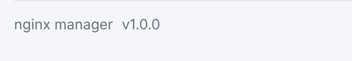

