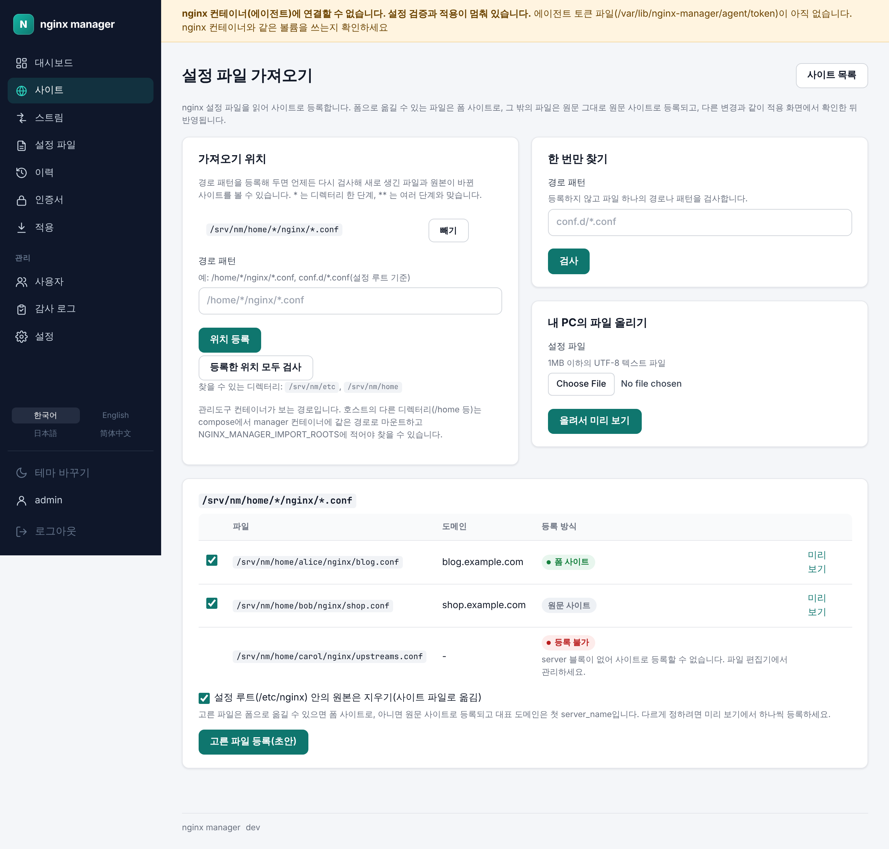
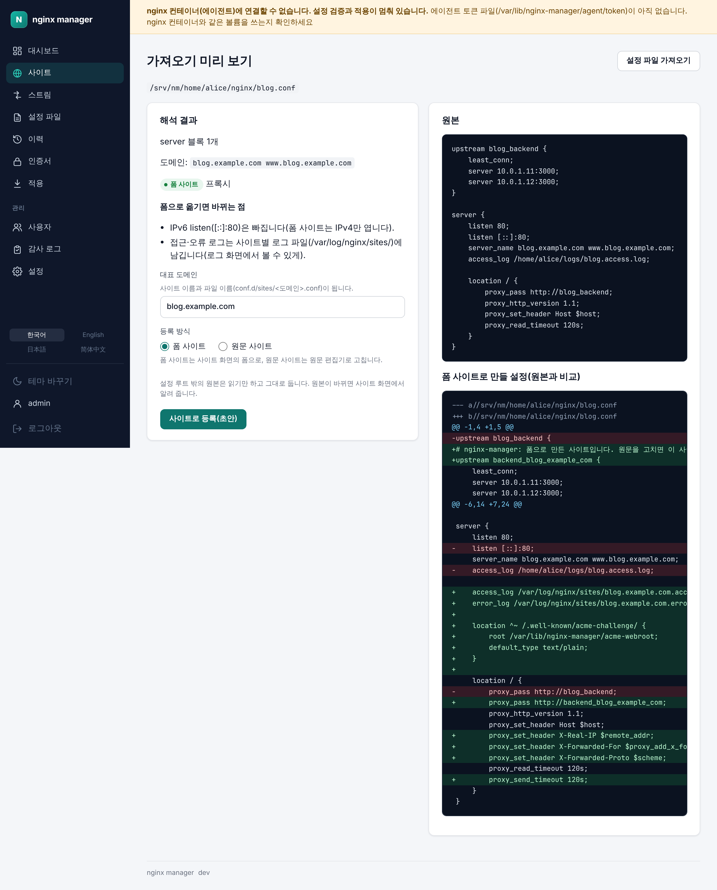
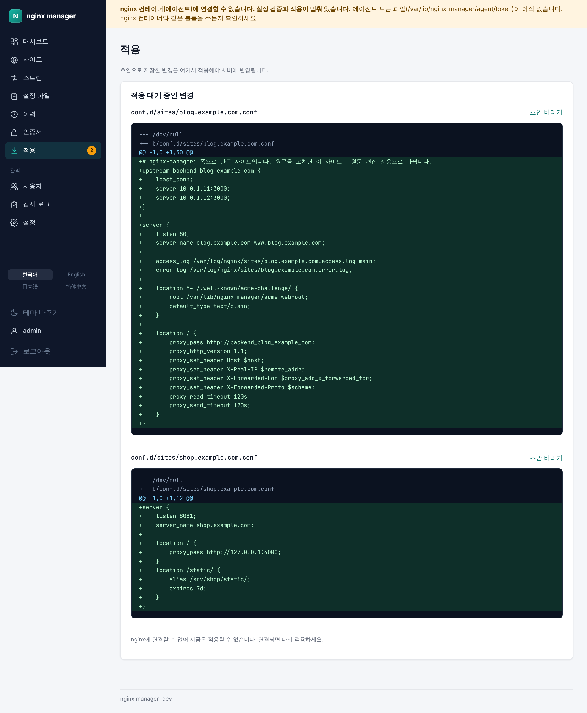

# v1.1.0 — 쓰던 nginx 설정 파일을 사이트로 가져오기, 쓰기 편해진 관리 화면

- 날짜: 출시 예정
- 이미지: `ghcr.io/nginx-manager/app:1.1.0`, `ghcr.io/nginx-manager/nginx:1.1.0`
- nginx: v1.0.0과 같음

이미 운영하던 nginx 설정 파일을 관리도구의 사이트로 옮겨 올 수 있습니다. `/home/*/nginx/*.conf`처럼 경로 패턴을 등록하면 맞는 파일을 모두 찾아 한꺼번에 등록하고, 원본이 바뀌면 알려 줍니다. 1.0.0의 화면을 처음부터 끝까지 다시 써 보며 불편했던 곳도 다듬었습니다(명세: nginx-manager/docs `specs/004-ui-usability/`).

> 화면은 개발 중 그림입니다. 릴리스할 때 [릴리스 절차](README.md#릴리스-절차)대로 실제 스택에서 다시 찍습니다.

## 설정 파일 가져오기

사이트 목록의 **설정 파일 가져오기**에서 가져올 파일을 지정합니다.

- **가져오기 위치**: 경로 패턴(`*`, `**`, `?`, `[]`, `{}`)을 등록해 두고 언제든 다시 검사합니다. 파일마다 새 파일(폼/원문), 등록됨, 원본 바뀜, 도메인 겹침, 등록 불가(이유)가 보이고, 고른 파일을 한꺼번에 사이트 초안으로 만듭니다.
- **한 번만 찾기**와 **내 PC의 파일 올리기**로 파일 하나를 바로 가져올 수도 있습니다.
- 파일을 읽어 사이트 폼(프록시·정적·리디렉션, 백엔드 여러 개·부하 분산·웹소켓·타임아웃, gzip, 자동 목록, 최대 요청 크기)으로 빠짐없이 옮길 수 있으면 **폼 사이트**로, location이 여럿이거나 HTTPS server처럼 폼에 없는 설정이 하나라도 있으면 원문 그대로 **원문 사이트**로 등록합니다. 설정이 조용히 빠지거나 바뀌지 않습니다.
- 미리 보기에서 폼으로 옮기면 무엇이 바뀌는지(로그 경로, IPv6 listen 등)와 만들어질 설정을 원본과 비교해 봅니다.
- 가져온 사이트는 `conf.d/sites/<도메인>.conf` 초안이 되고, 다른 변경과 같이 적용 화면에서 확인한 뒤 반영됩니다. `/etc/nginx` 안의 원본은 삭제 초안과 함께 적용되고 함께 버려집니다. 그 밖의 원본은 읽기만 합니다.
- 원본이 바뀌면 사이트 화면에서 **원본에서 다시 가져오기**로 새 초안을 만듭니다(HTTPS 등 관리도구에서만 정한 설정은 유지).

## 사이트 폼은 고른 유형의 항목만 보여 줍니다

리버스 프록시를 고르면 프록시 대상과 세부 설정만, 정적 파일을 고르면 문서 루트만, 리디렉션을 고르면 보낼 주소·응답 코드만 보입니다. 리디렉션 항목은 더 이상 접힌 상자 안에 있지 않습니다. 저장할 때의 검증과 만들어지는 설정은 전과 같습니다.

- 유형을 바꾸자마자 다른 칸을 입력해도 설정 미리보기가 마지막 입력까지 반영합니다.
- 넓은 화면에서는 긴 폼을 내려도 미리보기가 화면에 남습니다(사이트·스트림 추가).

## 목록과 적용 화면

- 사이트 목록의 대상 칸에 프록시는 백엔드 주소, 정적은 문서 루트, 리디렉션은 보낼 주소가 보이고, HTTPS를 켠 사이트는 포트 옆에 HTTPS가 표시됩니다. 활성/비활성과 적용 대기는 상태 칸 하나에 함께 보입니다.
- 적용 화면은 파일마다 diff를 접고 펼 수 있고, 파일 이름 옆에 더한 줄·뺀 줄 수(+17 −0)가 보입니다.
- 사이트 화면의 활성화/비활성화 버튼이 설정 원문 아래에서 제목 옆(로그 보기 옆)으로 옮겨졌습니다.
- 대시보드의 설치된 모듈 목록은 접어 두고, 제목을 누르면 펼칩니다.
- 사용자 추가의 역할 선택이 영문 코드 대신 화면의 역할 이름으로 보입니다.

## 휴대폰에서

- 좁은 화면에서는 가로로 밀어 보던 메뉴 대신 오른쪽 위 메뉴 버튼으로 메뉴를 엽니다. 적용 대기 수는 버튼에도 보입니다.
- 사이트·스트림 화면의 긴 설정 줄이 페이지 전체를 옆으로 밀던 문제를 고쳤습니다. 설정 원문은 상자 안에서만 가로로 스크롤됩니다.

## 고친 문제

- 사이트·스트림 폼에서 앞선 미리보기 응답이 도착하며 바로 다음 입력의 미리보기 요청이 사라져, 미리보기가 비거나 예전 설정에 머물던 문제를 고쳤습니다.

## 업그레이드할 때

- 호스트의 디렉터리(예: `/home`)에서 가져오려면 compose 파일의 `manager` 서비스에 같은 경로로 읽기 전용 마운트(`- /home:/home:ro`)를 더하고 `NGINX_MANAGER_IMPORT_ROOTS: /home`을 적은 뒤 `docker compose up -d manager`로 다시 띄웁니다. 관리도구는 UID 10101로 돌므로 파일을 읽을 수 있어야 합니다. `/etc/nginx` 안의 파일은 설정 없이 가져올 수 있습니다.
- DB 마이그레이션(V9)이 시작할 때 자동으로 적용됩니다.
