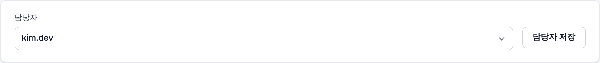
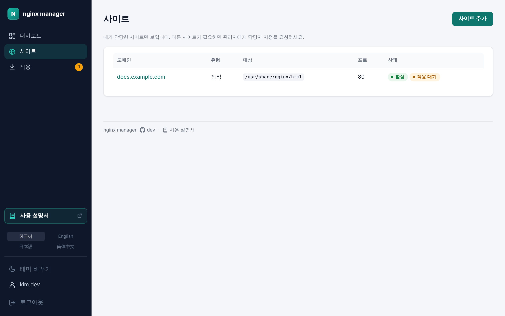
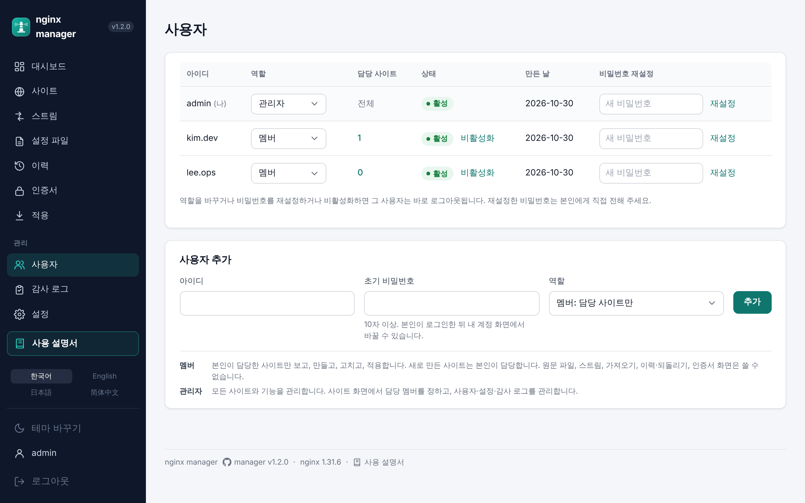
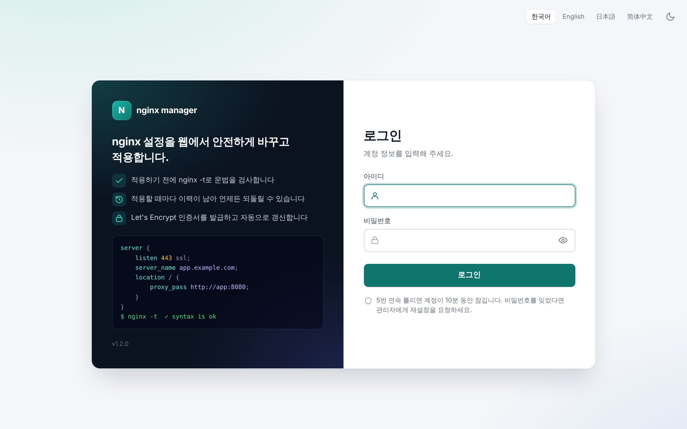
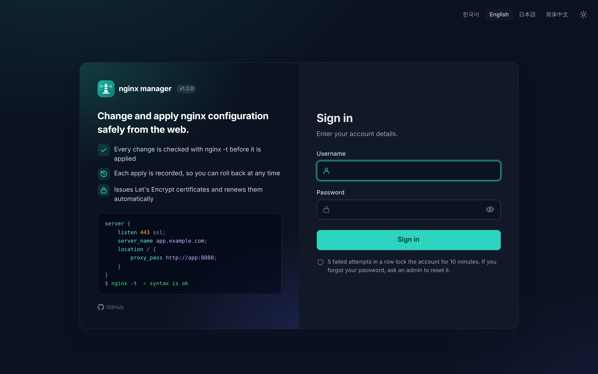
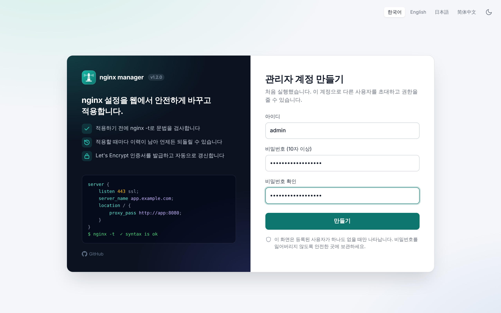
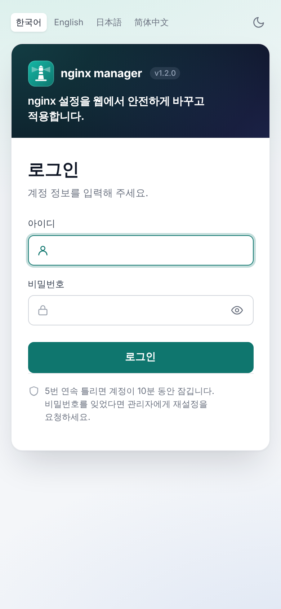
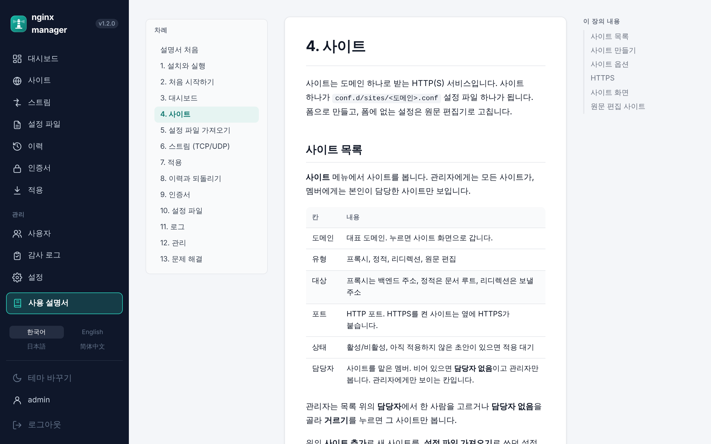
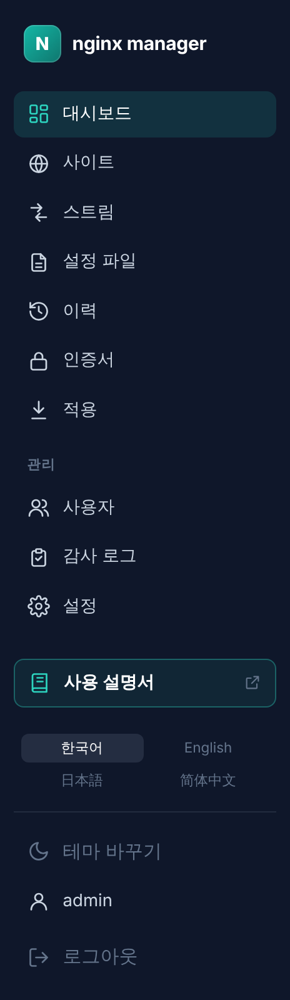
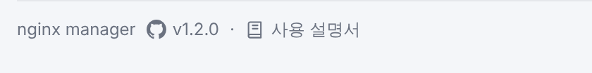

# v1.2.0 — 사용자별 사이트 관리, 새 로그인 화면, 관리 화면 안의 사용 설명서

- 날짜: 출시 예정
- 이미지: `ghcr.io/nginx-manager/app:1.2.0`, `ghcr.io/nginx-manager/nginx:1.2.0-nginx<릴리스할 때의 nginx 버전>`
- nginx: 릴리스할 때의 최신 정식 버전

> 출시 전 초안입니다. v1.1.0 이후에 개발한 것을 모두 담고, 출시할 때 날짜·nginx 버전을 적고 화면을 다시 찍습니다.

사용자마다 담당 사이트만 관리하도록 역할을 관리자와 멤버로 나눴습니다. 로그인·최초 설정 화면을 새로 만들었고, 설치부터 문제 해결까지 다룬 사용 설명서를 관리 화면 안에서 볼 수 있게 했습니다. 메뉴와 footer에서 바로 엽니다.

## 사용자별 사이트 관리

역할을 **관리자**와 **멤버** 둘로 정리하고, 사이트마다 담당자를 둡니다.

- 멤버는 자기가 담당한 사이트만 보고, 만들고, 고치고, 적용합니다. 멤버가 만든 사이트는 그 멤버가 담당합니다.
- 멤버가 적용하면 자기 사이트의 초안만 반영됩니다. 검증, reload, 실패 시 자동 복구, 버전 기록은 그대로입니다.
- 관리자는 사이트 화면에서 담당자를 지정·변경·해제하고, 사이트 목록에서 담당자 칸과 거르기를, 사용자 화면에서 사람마다 담당 사이트 수를 봅니다.
- 원문 설정 파일, 스트림, 설정 파일 가져오기, 이력과 되돌리기, 인증서 화면은 관리자만 쓰고, 멤버의 메뉴에서는 보이지 않습니다.

<p align="center"></p>

<p align="center"></p>

<p align="center"></p>

## 서버에 한 줄로 설치하기

설치 묶음(`nginx-manager.tar.gz`)과 `install.sh`를 릴리스마다 GitHub Release에 올립니다. Docker와 Compose v2가 있는 서버에서 한 줄로 `/opt/nginx-manager`에 설치합니다.

```bash
curl -fsSL https://github.com/nginx-manager/app/releases/latest/download/install.sh \
  | sudo sh -s -- --admin-domain nm.example.com --email ops@example.com
```

- `--admin-domain`을 주면 그 도메인에 Let's Encrypt 인증서를 받아 관리 화면을 HTTPS로만 열고, 80은 443으로 넘깁니다. 주지 않으면 관리 화면은 서버 안의 `127.0.0.1:9000`에만 열립니다.
- 포트, 도메인, 버전은 `.env`에서 정합니다.
- `nm` 명령으로 운영합니다. `nm upgrade`는 관리 화면만 올리고 nginx는 계속 트래픽을 받습니다. `nm upgrade --nginx`는 새 nginx로 설정을 먼저 검증한 뒤 몇 초 만에 다시 띄웁니다. 그 밖에 `nm status`, `nm backup`, `nm restore`, `nm migrate`가 있습니다.
- 관리 화면과 nginx 이미지를 따로 올릴 수 있습니다. 버전이 달라도 경고하지 않고, 에이전트 API가 맞지 않을 때만 알립니다.
- footer에 관리 화면과 nginx 버전이 함께 보이고, 로그인 화면에 GitHub 링크와 로고 옆 버전 배지가 생겼습니다.

## 새 로그인·최초 설정 화면

왼쪽에 제품 소개(한 줄 설명, 주요 기능 셋, 설정 예시, 버전), 오른쪽에 입력 칸을 두는 두 칸 화면으로 바꿨습니다.

- 입력 칸에 아이콘을 넣고, 비밀번호 보기 버튼과 Caps Lock 알림을 더했습니다(스크립트가 꺼져 있으면 숨김).
- 로그인 전에도 언어 옆 버튼으로 테마(밝게/어둡게)를 바꿀 수 있습니다.
- 좁은 화면(760px 이하)에서는 위아래로 쌓고 소개는 한 줄만 남깁니다.
- 새 문구는 한국어·영어·일본어·중국어(간체)로 모두 들어 있습니다.

<p align="center"></p>

<p align="center"></p>

<p align="center"></p>

<p align="center"></p>

## 관리 화면 안에서 보는 사용 설명서

설치부터 문제 해결까지 다룬 [사용 설명서](../../src/main/resources/guide/ko/README.md)를 더했습니다. 설치, 처음 시작하기, 대시보드, 사이트, 설정 파일 가져오기, 스트림, 적용, 이력, 인증서, 설정 파일, 로그, 관리, 문제 해결까지 13장이고, 실제 화면 그림이 함께 있습니다.

- 설명서는 GitHub가 아니라 관리 화면 안의 **사용 설명서**(`/guide`)에서 같은 탭으로 열립니다.
- 왼쪽에 장 목차가 있고, 넓은 화면에서는 오른쪽 **이 장의 내용**으로 장 안을 오갑니다. 장 끝에는 이전·다음 장 링크가 있고, 휴대폰에서는 목차가 본문 위에 접힙니다.
- 화면 틀은 4개 언어로 나오고 본문은 한국어로만 제공합니다. 다른 언어로 보면 그 안내가 함께 나옵니다.
- 왼쪽 메뉴 아래의 **사용 설명서** 단추와 footer의 링크로 엽니다. footer의 버전 링크 앞에는 GitHub 아이콘이 붙었고, 버전을 누르면 지금처럼 그 버전의 릴리스 노트가 열립니다.

<p align="center"></p>

<p align="center"></p>

<p align="center"></p>

## 브라우저 탭 아이콘

브라우저 탭과 북마크, iOS 홈 화면에 nginx manager 아이콘이 보입니다. 화면 왼쪽 위 로고와 같은 모양(청록 그라데이션 위 흰 N)이고, 로그인 전과 최초 설정 화면에서도 나옵니다.

## 업그레이드할 때

- v1.0·v1.1을 `docker-compose.yml`로 쓰던 서버는 새 방식으로 옮깁니다. `install.sh`를 `--no-start`로 실행한 뒤 `/opt/nginx-manager/nm migrate`로 기존 볼륨을 옮깁니다.
- 처음 띄울 때 데이터베이스가 저절로 새 역할로 옮겨집니다.
- 기존 **편집자**와 **보기 전용** 계정은 모두 **멤버**가 됩니다. 관리자 계정은 그대로입니다.
- 기존 사이트에는 담당자가 없습니다. 관리자가 사이트 화면에서 담당자를 지정하기 전까지 멤버에게는 사이트가 하나도 보이지 않으니, 업그레이드한 뒤 바로 담당자를 지정하세요.
